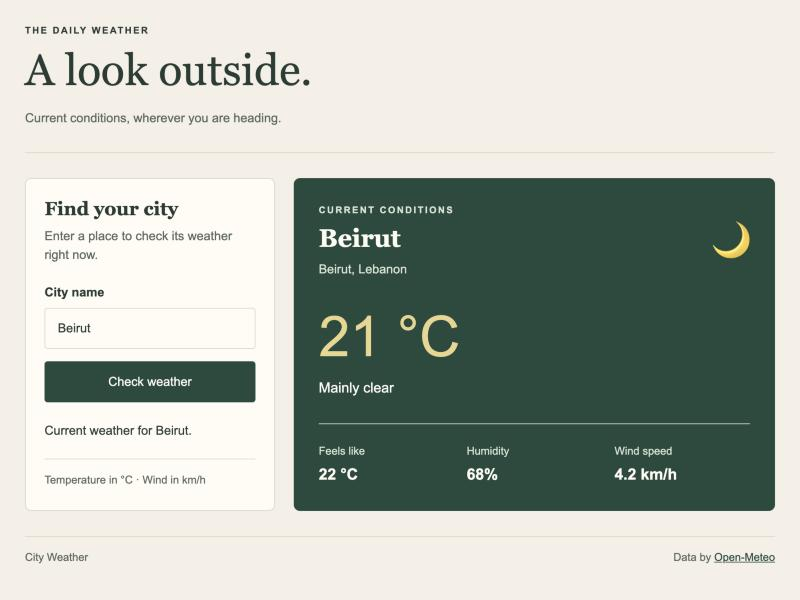

# City Weather (React)

Assignment 5: my Assignment 4 weather dashboard rebuilt as a React application
with Vite. It keeps the same design: a cream background, a green weather panel,
and the city search beside the results on desktop. The sections stack on
smaller screens.

## How to install and run

You need Node.js (version 20 or newer).

1. Extract `ralphassiweb5.zip` and open the folder in VS Code.
2. Open a terminal in the folder and install the dependencies:

   ```
   npm install
   ```

3. Start the dev server:

   ```
   npm run dev
   ```

4. Open the address shown in the terminal (usually http://localhost:5173).
5. Type a city name and click **Check weather**, or press Enter.

An internet connection is required. The weather comes from Open-Meteo, so no
account or API key is needed.

Other scripts: `npm run build` makes a production build in `dist/`,
`npm run preview` serves it, and `npm run lint` checks the code.

## Components

Each component is a function component in its own file in `src/components/`.

```
App                   state: search, status, message, weather
├── PageHeader
├── SearchPanel       props: isLoading, status, message, onSearch
│   ├── SearchForm    state: city (what is typed)   props: isLoading, onSearch
│   └── StatusMessage props: status, message
├── LoadingPanel      (while loading)
├── WeatherPanel      (after a successful search)   props: place, current
│   └── WeatherDetails                              props: current
│       └── DetailItem × 3                          props: label, value
├── EmptyState        (before a search, or after an error)
└── Footer
```

- `src/api/openMeteo.js`: the two fetch requests and the error messages.
- `src/utils/conditions.js`: weather codes to a description and an emoji.
- `src/index.css`: colors, typography, Grid, Flexbox, and media queries.

## State and effects

- `SearchForm` keeps the text being typed in its own `useState`, because no
  other component needs it. It only calls `onSearch` when the form is sent.
- `App` keeps the current `search`, the `status` (idle, loading, success, or
  error), the `message` under the form, and the `weather` data.
- Each search gets a new id, so searching the same city again after an error
  fetches again.
- The first `useEffect` runs when `search` changes and loads the weather. If a
  new search starts before the old one answers, the old answer is ignored
  (the cleanup sets an `ignore` flag), so an older result never replaces a
  newer one.
- The second `useEffect` puts the city name in the browser tab title.

Props go at most two levels down (for example App → SearchPanel → SearchForm),
so no context was needed.

## Loading, error, and success

While loading, the button shows "Loading...", the form is disabled, and the
right side shows "Checking the sky...". Empty input, missing cities, network
failures, HTTP errors, rate limits, and missing readings all have messages on
the page. After a success, the green panel shows the city, region, temperature,
sky conditions, feels-like temperature, humidity, and wind speed.

- Weather API: https://open-meteo.com/en/docs
- City search: https://open-meteo.com/en/docs/geocoding-api

## Screenshot


